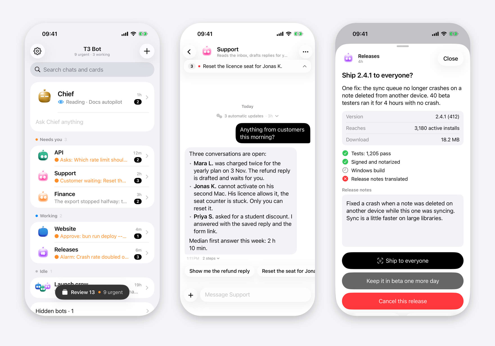
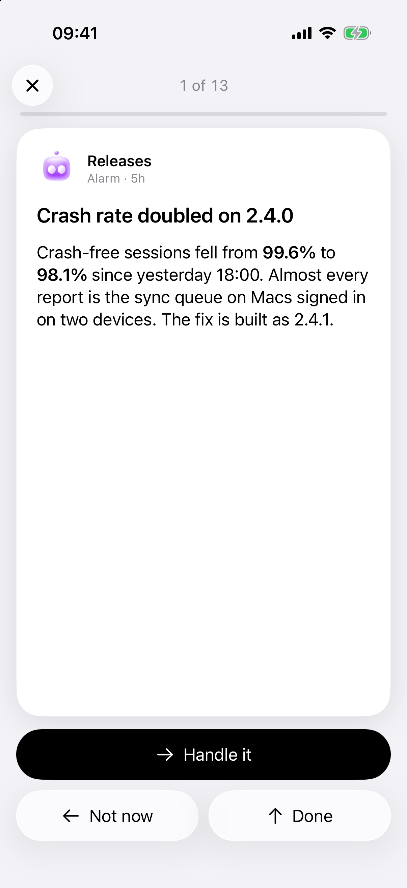
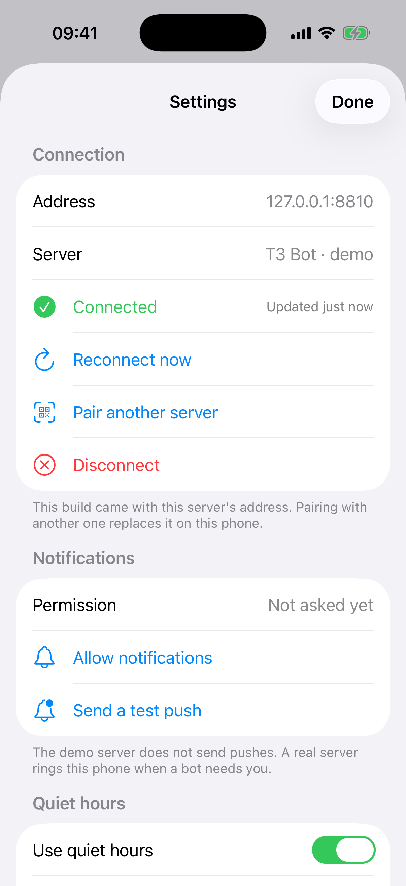
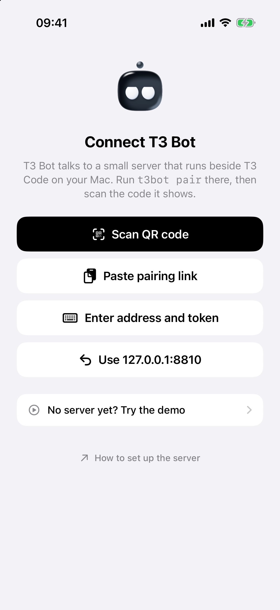
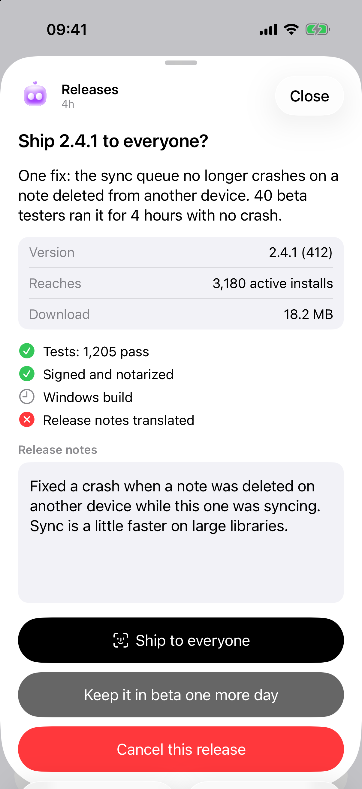

<p align="center">
  <picture>
    <source media="(prefers-color-scheme: dark)" srcset="docs/bots-dark.png">
    
  </picture>
</p>

<h1 align="center">T3 Bot</h1>

<p align="center">An unofficial iPhone app for <a href="https://github.com/pingdotgg/t3code">T3 Code</a>, written from scratch as a simpler alternative to its own mobile app. Each bot is a T3 Code thread you chat with like a contact, in the spirit of agent apps like xAI's Grok Bot, and one ranked list shows what needs you, so an agent's question reaches your lock screen and you can answer it there.</p>



## Try it in five minutes

The demo is a pretend server with made-up bots that answer everything, and the app in the iPhone simulator. It needs no T3 Code, no account and no signing, only a Mac with [Bun](https://bun.sh), Xcode 27 and [XcodeGen](https://github.com/yonaskolb/XcodeGen) (`brew install xcodegen`).

```sh
git clone https://github.com/Soren-Starck/t3-bot
cd t3-bot
bin/t3bot demo
```

Leave it running. In a second terminal, open the app in Xcode:

```sh
cd t3-bot/ios
xcodegen generate
open T3Bot.xcodeproj
```

Choose the `T3Bot` scheme and an iPhone simulator, then Run. On the connect screen, open "No server yet? Try the demo" and tap "Connect to the demo on this Mac". Send a bot a message and it answers a few seconds later.

`t3bot demo` also prints a QR code and a pairing link, for an app that is already on a phone on the same Wi-Fi. Nothing is saved when it stops, and it sends no pushes, so notifications are the one part the demo cannot show.

## What it is

A small server that runs next to T3 Code on your Mac, an iPhone app you build yourself, and a `t3bot` command for scripts and agents. Your bots are ordinary T3 threads, so everything you do on the phone is also in T3 Code on the desktop.

How it compares, honestly:

- **Not a fork.** The app, the server and the command line were written for this project. The only outside code is the BoopFace faces (MIT).
- **T3 Code's own mobile app** (App Store and Google Play) is a full client: projects, threads, diffs, a terminal, files, pull requests, voice input, and pushes through T3 Connect. T3 Bot does much less on purpose: it shows only the threads you turn into bots, plus anything waiting on you from any thread, in a native SwiftUI app for iPhone only. Its pushes come from a server and an Apple push key you run yourself, with no account.
- **Grok Bot** runs its own model and drives T3 Code for you. T3 Bot has no model of its own: each bot is a T3 Code thread, and you talk to the agent T3 Code runs in it.
- **It reaches into T3 Code's internals** (its database and local websocket), not a public API, so a T3 Code update can break it.

T3 Bot is not affiliated with, endorsed by or supported by T3 Code, Ping or xAI.

What it does:

- **Your bots as contacts.** Make a bot from the phone: a name, a job and a face, and it gets its own new T3 thread. Open it like a chat: send text or photos, see what it is doing while it works, tap a suggested reply. Turning a thread you already have into a bot means adding it to the config file.
- **One list of what needs you.** Questions and approvals from any T3 thread, cards from your own scripts and notes from your agents, ranked most urgent first.
- **Answer from the lock screen.** An agent's question arrives as a notification you can answer in place. An approval has Approve and Decline buttons, and a bot's reply has a Reply field.
- **Pushes that say which bot.** Notifications show the bot's name and face as the sender, like a message from a person.
- **Review.** Go through the list one card at a time: swipe to act or to put a card off, with Undo.
- **Quiet hours.** Pushes wait during the night and one morning summary replaces them. Alarms can still ring.
- **Widgets and a Live Activity.** The list on your Home Screen and Lock Screen, and the bot that is working right now.
- **Share sheet.** Send a link, text or images from any app to a bot.
- **`t3bot notify` from anything.** A script, a cron job or an agent puts a card on your phone with one command.

Settings, behind the gear on the home screen, holds the connection, notifications and a test push, quiet hours, the morning brief, the calendar and contacts you share with your bots, and your quick replies. Quick replies are short answers you save once, such as "Yes, go ahead". They show under a bot's message when it asks you something and suggests no replies of its own.

<p>
  
  
</p>

## Use it with your T3 Code

The full walkthrough is in [docs/SETUP.md](docs/SETUP.md). The short version:

On the Mac that runs T3 Code, with T3 Code open:

```sh
git clone https://github.com/Soren-Starck/t3-bot
cd t3-bot
deploy/install.sh
```

The installer starts the server at login, links the `t3bot` command into `~/.local/bin`, creates your first bot in a T3 Code project (it asks which one when you have several) and prints a QR code. `t3bot doctor` then checks T3 Code, the config, the token, the server, the address your phone will use and the push key.

Build the app to your phone with your own team:

```sh
ios/scripts/setup.sh --team <your team id> --bundle-id <an identifier of your own>
open ios/T3Bot.xcodeproj
```

Run it on the phone and scan the QR code from the app's connect screen. `t3bot pair` prints the code again.



## How it talks to T3 Code

- It **reads** T3 Code's local SQLite database, opened read only. That is how it knows your threads, their messages, what a run is doing and which questions are waiting.
- It **writes** through T3 Code's local websocket, with a session token issued by T3 Code's own command line tool. Sending a message, answering a question and creating a bot's thread all go through T3 Code's own commands, never around them.
- A bot is an ordinary T3 thread titled `%BOT <Name>`. Open it in T3 Code and it is the same conversation.
- Nothing leaves your machines. With Tailscale connected, the server listens on `127.0.0.1` only and Tailscale Serve gives it an HTTPS address inside your tailnet. Without Tailscale, the installer opens it to your home network over plain http, which is for use at home only. The only outside service is Apple's push service, and only if you add a push key.

T3 Bot uses parts of T3 Code that are not a public API, so a T3 Code update can break it. `t3bot doctor` is the first thing to run when something stops working. More in [docs/ARCHITECTURE.md](docs/ARCHITECTURE.md).

## Requirements

- macOS with T3 Code installed and running. The demo needs only Bun, Xcode and XcodeGen.
- [Bun](https://bun.sh). The server has no other dependencies.
- Xcode 27 and an iPhone on iOS 26. The app is iPhone only.
- A way for the phone to reach your Mac. Tailscale on both is recommended: the installer then gives the server an HTTPS address that works away from home. Without it the phone must be on the same Wi-Fi as the Mac.
- Google Chrome or Chromium on the Mac that runs the server, optional. The server uses it headless to draw the still picture of a new bot's face in its own colours, for notifications. Without it notifications show the stock picture of the bot's face. The animated faces in the app do not need it.
- For pushes: your own APNs key, which needs a paid Apple Developer account. Without it the app works whenever it is open, and no notifications arrive.
- To install on a real iPhone: a paid Apple Developer account. The app uses push and communication notification entitlements, which a free personal team cannot sign.

There is no TestFlight or App Store build yet. Pushes are sent by your own server with your own key to an app signed by your own team, and a shared build would need a shared push service that does not exist. Until then you build the app yourself.

## Your own cards

Anything that can run a command can put a card on your phone:

```sh
t3bot notify --kind approve --title "Deploy 2.4.1 to production?" \
  --check "Tests=pass" --check "Staging=pass" \
  --action "Deploy=Run the production deploy for 2.4.1"
```



A **card source** is a command that prints a list of cards as JSON, such as your to-do list or your open pull requests. A **handler** is a command that a card's button runs on your Mac. Both are a few lines in the config file. The format and copyable examples are in [docs/CARDS.md](docs/CARDS.md).

## Docs

- [docs/SETUP.md](docs/SETUP.md): install, signing with your own team, the push key, pairing, troubleshooting.
- [docs/CARDS.md](docs/CARDS.md): `t3bot notify`, the card format, sources and handlers.
- [docs/ARCHITECTURE.md](docs/ARCHITECTURE.md): the pieces and how they fit.
- [CONTRIBUTING.md](CONTRIBUTING.md)

## Credits

- Bot faces are [BoopFace](ios/T3Bot/BoopFace/LICENSE) by CX ArtLab, MIT.
- [T3 Code](https://github.com/pingdotgg/t3code) by Ping, MIT. T3 Bot does not include its code.

## License

[MIT](LICENSE)
