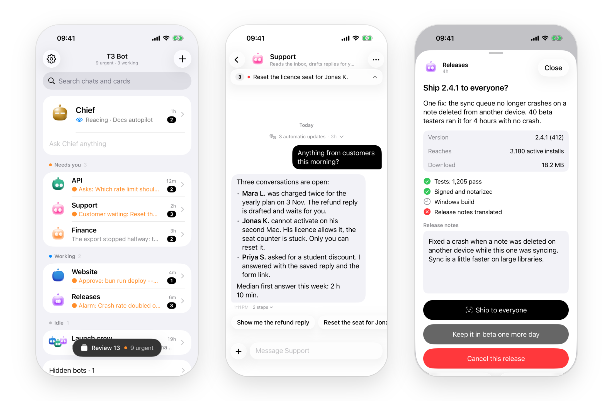

<p align="center">
  <picture>
    <source media="(prefers-color-scheme: dark)" srcset="docs/bots-dark.png">
    
  </picture>
</p>

<h1 align="center">T3 Bot</h1>

<p align="center">An unofficial, open source iPhone app for people who run agents in <a href="https://github.com/pingdotgg/t3code">T3 Code</a>. Each bot is a T3 Code thread with a name and a face. Home shows who is working and who waits on you, and the phone rings when an agent finishes or needs you. It pairs straight with T3 Code, with nothing to install beside it.</p>

<picture>
  <source media="(prefers-color-scheme: dark)" srcset="docs/screenshots/hero-dark.png">
  
</picture>

## Before you start

- **T3 Code 0.1.0 or later.** Older ones are refused at pairing. The newest checked are stable 0.1.8 and the main branch of 11 Nov 2026.
- **You build it yourself.** There is no TestFlight or App Store build. You need a Mac with Xcode 27, an iPhone on iOS 26 and a paid Apple Developer account.
- **Notifications are off in a fresh build.** Apple only lets an app's signing team send it pushes, so the phone rings only after you deploy your own push sender ([push/README.md](push/README.md)). Until then the app works and stays silent.
- **Only Claude threads ring.** Codex threads show in the app and send no notification yet.

## Build, scan, done

With T3 Code running on your computer:

```sh
brew install xcodegen
git clone https://github.com/Soren-Starck/t3-bot
cd t3-bot
ios/scripts/setup.sh
```

`setup.sh` asks for your Apple team ID and a bundle identifier prefix of your own, then generates the Xcode project. Then either:

- `open ios/T3Bot.xcodeproj`, choose the `T3Bot` scheme and your iPhone, and press Run;
- or plug in the iPhone, unlock it and run `ios/scripts/run-on-iphone.sh`.

In T3 Code, open Settings > Sharing & access and create a link. In T3 Bot, tap "Scan the code from T3 Code". Threads titled `%BOT <Name>` show as bots, and you make new ones from the phone. Away from home, pair with your T3 Connect address under "Other ways to connect".

Or paste this into Claude Code, Codex or a T3 Code thread on the Mac that has Xcode:

```text
Set up T3 Bot for me: https://github.com/Soren-Starck/t3-bot
Clone it somewhere permanent and follow docs/AGENT-SETUP.md step by
step. Run every command you can yourself, and stop to tell me exactly
what to do when a step needs me (my Apple account, Xcode, my iPhone).
Never print a pairing code, a token or a key.
```

[docs/SETUP.md](docs/SETUP.md) has every step. To look first, [the demo](docs/SETUP.md#the-demo) runs the app in the simulator with no T3 Code and no Apple account (it needs [Bun](https://bun.sh)).

## Notifications

Deploy your push sender, a free Vercel function ([push/README.md](push/README.md)), then point the build at it and install again:

```sh
ios/scripts/setup.sh --push-host <your sender's host name>
```

The app then adds Claude Code hooks to T3 Code's Claude provider settings. A Claude thread that asks a question or needs an approval rings, and so does a bot that finishes a reply. Settings > Notifications > "Ring this phone" takes the hooks out again. The sender holds your Apple push key and learns which thread rang, nothing about the work: the phone reads the words from T3 Code.

## The optional server

A T3 Bot server can run beside T3 Code, and the phone pairs with it instead. It adds cards from your own scripts (`t3bot notify`, [docs/CARDS.md](docs/CARDS.md)), drafts, pushes held during quiet hours, a morning brief, and notifications from every thread, Codex included, with no push sender. It needs [Bun](https://bun.sh) and a Mac that stays on: see [the setup guide](docs/SETUP.md#optional-the-t3-bot-server).

The app holds one pairing at a time. Switching between T3 Code and a server forgets the chats and drafts saved on the phone.

## How it works

The app trades the link's one-time code for a token, reads your threads over T3 Code's HTTP API and follows changes over its websocket (the Swift package in `ios/Direct`). This is the API T3 Code's own clients use, not a documented public one, so a T3 Code update can break T3 Bot. More in [docs/ARCHITECTURE.md](docs/ARCHITECTURE.md).

## Docs

[Setup](docs/SETUP.md) · [Setup for agents](docs/AGENT-SETUP.md) · [Cards](docs/CARDS.md) · [Architecture](docs/ARCHITECTURE.md) · [Contributing](CONTRIBUTING.md) · [Security](SECURITY.md) · [Changelog](CHANGELOG.md)

MIT. Faces: [BoopFace](ios/T3Bot/BoopFace/LICENSE) by CX ArtLab, MIT. Not affiliated with T3 Code, Ping or xAI.
