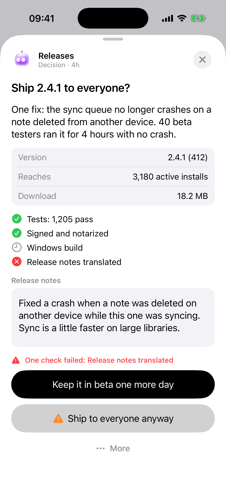

# Cards

A card is one thing that needs you. The app shows every card in one list, most urgent first, and under the bot it belongs to.

<picture>
  <source media="(prefers-color-scheme: dark)" srcset="screenshots/card-dark.png">
  
</picture>

Cards come from three places:

| Where | How it gets there | Example |
|---|---|---|
| T3 Code | Automatically. Any thread that asks a question or waits for an approval | "Which branch should I base this on?" |
| A note | Someone runs `t3bot notify` | "Deploy 2.4.1 to production?" |
| A source | A command of yours that prints a list as JSON, run on a timer | Your to-do list, open pull requests, support tickets |

You do nothing for the first kind, and it works with either pairing: straight with T3 Code, or through the T3 Bot server.

The other two kinds need the [optional server](SETUP.md#optional-the-t3-bot-server), and so do [handlers](#handlers) and [drafts](#drafts-for-your-phone): the `t3bot` command talks to the server, and an app paired straight with T3 Code shows none of them. The rest of this page is about them.

## Notes: `t3bot notify`

```sh
t3bot notify --kind do --title "Renew the domain before Friday"
```

| Flag | Meaning |
|---|---|
| `--kind` | `alarm`, `approve`, `do` or `know`. Default `know` |
| `--title` | Required. One line |
| `--body` | Optional detail |
| `--agent <id>` | The bot the card belongs to. Default: your chief bot |
| `--link <url>` | A link the card opens |
| `--key <stable-key>` | Makes the card replaceable. See below |
| `--field "Label=Value"` | A labelled value on the card. Repeatable |
| `--check "Label=pass"` | A check with state `pass`, `fail` or `pending`. Repeatable |
| `--edit "text"` | Text you can edit on the phone before acting. `--edit-label` names it |
| `--action "Label=instruction"` | A button. Tapping it sends the instruction to the card's bot. Repeatable |
| `--face-id` | Ask for Face ID before the card's action buttons act (yours, or Handle it when you give none). Done and Not now never ask |

### Kinds

| Kind | Where it ranks | Push |
|---|---|---|
| `alarm` | Top, with questions | At once, time sensitive. Rings at night too if you allow alarms in settings |
| `approve` | Next | At once by day. Held during quiet hours |
| `do` | After approvals | At once by day. Held during quiet hours |
| `know` | Not in the list | None. Collected into one evening summary of what agents did without you |

Use `know` for anything that is only information. A phone that rings for everything gets muted.

### Replace instead of repeat

A job that runs every hour should not leave twenty cards. Give it a key:

```sh
t3bot notify --kind alarm --agent ops --key disk-low \
  --title "Disk under 10 GB" --body "8.2 GB free on the build machine"
```

A later call with the same `--agent` and `--key` updates that card, brings it back if you had dismissed it, and rings again as its kind says. Without a key, every call makes a new card.

### Buttons that talk to the bot

```sh
t3bot notify --kind approve --agent releases \
  --title "Ship 2.4.1?" \
  --field "Changes=3 fixes" --check "Tests=pass" --check "Signed=pass" \
  --action "Ship it=Publish 2.4.1 now and tell me when it is live" \
  --action "Hold=Do not ship. Ask me again tomorrow morning" \
  --face-id
```

The first `--action` is the main button. Done and Not now are added after yours. Tapping a button sends its instruction to the bot's thread, with the card's title, and the bot does the work. The card then leaves the list. A card takes at most six buttons of yours.

### Text you can edit first

```sh
t3bot notify --kind approve --agent support \
  --title "Reply to Maya about the refund" \
  --edit "Hi Maya, the refund went out this morning. It can take three days to show." \
  --edit-label "Reply" \
  --action "Send=Send this reply to Maya"
```

The text is editable on the card. The bot receives it as you left it.

### From an agent

Agents run the same command. A line like this in a bot's instructions is enough:

```text
When you finish something I did not ask about, run:
  t3bot notify --agent <your id> --kind know --title "<what you did, one line>"
When you need a decision from me, ask it in this thread instead.
```

A question an agent asks in its T3 thread already reaches the phone as a card and a push. It does not need `notify` as well.

### Over HTTP

`t3bot notify` is a thin wrapper. Anything that can make a request can post a note:

```sh
curl -s -X POST http://127.0.0.1:8809/v1/notify \
  -H "Authorization: Bearer $(cat ~/.config/t3bot/token)" \
  -H 'content-type: application/json' \
  -d '{
    "kind": "approve",
    "agent": "releases",
    "key": "ship-2.4.1",
    "title": "Ship 2.4.1?",
    "body": "Three fixes since 2.4.0.",
    "fields": [{ "label": "Changes", "value": "3 fixes" }],
    "checks": [{ "label": "Tests", "state": "pass" }],
    "edit": { "label": "Release note", "text": "Fixes a crash on launch." },
    "actions": [
      { "label": "Ship it", "handler": "ship" },
      { "label": "Ask the bot", "message": "Look at the diff once more and tell me if it is safe" }
    ],
    "faceId": true
  }'
```

An action with `handler` runs a command on your Mac (see [Handlers](#handlers)). An action with `message` goes to the bot. Handler buttons are only available this way, not through the `--action` flag.

## Sources

A source is a command that prints the current list of cards. The server runs it on a timer and shows what it prints. Your to-do app, your tracker or a folder of files can all be a source with a short script.

Add it to the config file:

```json
"sources": [
  {
    "id": "todo",
    "name": "To-do",
    "agent": "chief",
    "list": ["python3", "~/.config/t3bot/adapters/todo.py", "list"],
    "done": ["python3", "~/.config/t3bot/adapters/todo.py", "done", "{id}"],
    "ttl": 60
  }
]
```

| Key | Meaning |
|---|---|
| `id` | Short and stable. Card ids become `<source id>:<card id>` |
| `name` | Shown on the card as where it came from |
| `agent` | The bot these cards belong to unless a card says otherwise. Default: your chief bot |
| `list` | The command, as a list of arguments. It must print the JSON below |
| `done` | Optional. Run when you mark a card done, with `{id}` replaced by the card's id. Leave it out and cards from this source have no Done button |
| `ttl` | Seconds between runs. Default 30, never under 5 |
| `timeout` | Seconds the `list` command may take. Default 60. `done` has 30 seconds |

In `list`, `done` and a handler's `cmd`, a leading `~` is your home folder. A leading `./` is a file beside the config file, or in the T3 Bot clone when it is not there. The config is read again when it changes, so a new source shows up without a restart.

### What `list` prints

```json
{
  "cards": [
    {
      "id": "42",
      "title": "Renew the domain",
      "urgency": "today",
      "body": "Expires on Friday. About 12 euros.",
      "fields": [{ "label": "Registrar", "value": "example-registrar.test" }],
      "link": "https://example.test/domains"
    }
  ]
}
```

Only `id` and `title` are required. A card without either is dropped.

| Field | Meaning |
|---|---|
| `id` | Stable for the same item between runs |
| `title` | One line |
| `urgency` | `now`, `today`, `week` or `later`. Default `week`. A new card sends a push only when this is `now` or `today` |
| `rank` | A whole number, if you want exact control of the order: 0 and 1 count toward the app's badge, lower is higher in the list. It replaces the place `urgency` gives, not the push rule: keep `urgency` if the card should ring |
| `agent` | A bot id, to override the source's bot for this card |
| `group` | Overrides the source's `name` on this card |
| `at` | When the item was created, ISO time. Older first among equals |
| `body` | Detail text. `detail` is read too and wins when both are there |
| `why` | One line on why this one needs you and not the bot |
| `steps` | What to do, as text. The app shows it under "Steps" |
| `minutes` | Roughly how long it takes, a number |
| `customer` | `true` when a customer is waiting. Such a card goes before others of the same rank |
| `fields` | `[{ "label", "value" }]` |
| `checks` | `[{ "label", "state" }]` with `pass`, `fail` or `pending` |
| `edit` | `{ "label", "text" }`: text you can change before acting |
| `actions` | Your own buttons. See below |
| `faceId` | `true` to ask for Face ID before the default main button |
| `ref` | How the bot can find the item itself, in words. Used when the card is handed to the bot |
| `link` | A URL the card opens |

Rules the server follows:

- The command has 60 seconds unless the source sets `timeout`. If it fails or prints something that is not this JSON, the last good list stays on screen and the failure is logged.
- The cards a source already lists when the server first reads it send no push. Only ones that appear later do.
- A card you put off with Not now is hidden until the time you chose, then comes back if the source still lists it.
- A card disappears when the source stops printing it. There is no separate "delete".

### A source in 20 lines

This one turns a plain text file into cards, one line per item:

```python
#!/usr/bin/env python3
import json, sys, pathlib, hashlib

FILE = pathlib.Path.home() / "todo.txt"
lines = [l.strip() for l in FILE.read_text().splitlines() if l.strip()]
key = lambda l: hashlib.sha1(l.encode()).hexdigest()[:10]

if sys.argv[1] == "list":
    print(json.dumps({"cards": [
        {"id": key(l), "title": l.lstrip("! "), "urgency": "today" if l.startswith("!") else "week"}
        for l in lines
    ]}))
elif sys.argv[1] == "done":
    FILE.write_text("\n".join(l for l in lines if key(l) != sys.argv[2]) + "\n")
```

Test a source by running its `list` command yourself and reading the JSON before you add it to the config.

### Buttons

Without `actions`, a card gets three buttons: **Handle it** (hands the card to its bot, which does it or asks you one question), **Done** (only if the source has `done`) and **Not now**.

With `actions`, you choose:

```json
"actions": [
  { "id": "merge", "label": "Merge", "kind": "command", "handler": "merge-pr", "style": "primary", "faceId": true },
  { "id": "ask",   "label": "Review it first", "kind": "message", "message": "Review this pull request and tell me what worries you" },
  { "id": "snooze", "label": "Not now", "kind": "snooze" }
]
```

| `kind` | What the button does |
|---|---|
| `handle` | Sends the card to its bot's thread: do it, or ask one short question |
| `message` | Sends `message` to the bot, with the card's title and the edited text if the card has `edit`. The card stays until the source stops listing it |
| `command` | Runs the handler named in `handler` on your Mac |
| `done` | Runs the source's `done` command |
| `snooze` | Hides the card until later |

`style` is `primary`, `destructive` or `plain`. `faceId: true` asks for Face ID before the button acts.

## Handlers

A handler is a command a button runs directly, with no agent in between. Use it for actions that are exact and that you want done the moment you tap: merge, send, approve, restart.

```json
"handlers": {
  "merge-pr": { "cmd": ["python3", "~/.config/t3bot/adapters/merge-pr.py"] }
}
```

A handler has five minutes. `"timeout": 600` beside `cmd` gives it another limit, in seconds.

When you tap the button, the server runs `cmd` and writes one JSON object to its standard input:

```json
{
  "card": { "id": "prs:1234", "title": "Fix the login redirect", "fields": [], "...": "the whole card" },
  "action": { "id": "merge", "label": "Merge", "kind": "command", "handler": "merge-pr" },
  "text": "the edited text, if the card has an edit field"
}
```

- Exit 0 means it worked. The last 300 characters of standard output are shown in the app as the result.
- Any other exit code is an error. The app shows the end of standard error, or of standard output when that is empty.
- After a success the server refreshes every source, so a card whose item is gone disappears. A card made with `t3bot notify` is marked done.

```python
#!/usr/bin/env python3
import json, subprocess, sys

req = json.load(sys.stdin)
number = req["card"]["id"].split(":")[-1]
subprocess.run(["gh", "pr", "merge", number, "--squash"], check=True)
print(f"Merged #{number}")
```

A handler runs with your user's rights the moment a button is tapped. Keep each one narrow, and put `faceId` on any button whose effect you cannot undo.

## Reading the list from a script

```sh
t3bot needs
```

prints one line per card: rank, bot, source and title, or "Nothing needs you." when the list is empty. `t3bot needs --json` prints the cards as JSON. The whole home screen, bots included:

```sh
curl -s -H "Authorization: Bearer $(cat ~/.config/t3bot/token)" http://127.0.0.1:8809/v1/home
```

## Drafts for your phone

A bot can prepare a message, a mail or a calendar event for you to send from the phone. It never sends anything itself:

```sh
t3bot draft --agent chief --to "Maya" --text "Running ten minutes late" --via imessage
t3bot draft --agent chief --to "maya@example.test" --via mail --subject "Friday" --text "Works for me."
t3bot draft --agent chief --event "Dentist" --start 2026-12-01T15:00 --end 2026-12-01T15:30 --location "12 Example Street"
```

The draft arrives as a card. Opening it shows the system's own compose sheet with everything filled in, and you press Send.
