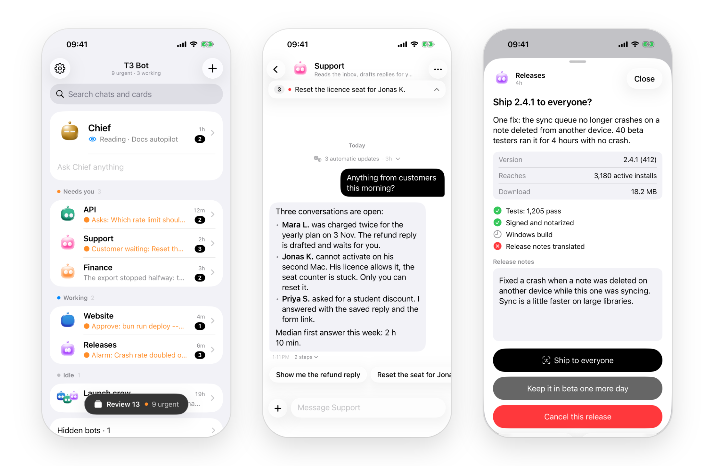

# T3 Bot 0.3.0 beta

T3 Bot is an unofficial, open source iPhone app for people who run agents in [T3 Code](https://github.com/pingdotgg/t3code). Each bot is a T3 Code thread with a name and a face. Home shows who is working and who waits on you, and the phone rings when an agent finishes or needs you.

This release removes the server from the setup. The app now pairs straight with T3 Code: scan a link from Settings > Sharing & access and your threads are on the phone. Nothing to install beside T3 Code.

Before you start, the limits:

- **You build it yourself**, with Xcode and a paid Apple Developer account. There is no TestFlight or App Store build.
- **Notifications need your own push sender.** A fresh build has none set, so nothing rings until you deploy one ([push/README.md](https://github.com/Soren-Starck/t3-bot/blob/v0.3.0/push/README.md)). Apple only lets an app's signing team send it pushes, so there is no shared one.
- **Paired straight with T3 Code, only Claude threads ring.** Codex threads show in the app and send no notification yet. With the optional server, every provider rings.
- **One pairing at a time.** Switching between T3 Code and a T3 Bot server forgets the chats and drafts saved on the phone.

<picture>
  <source media="(prefers-color-scheme: dark)" srcset="https://raw.githubusercontent.com/Soren-Starck/t3-bot/main/docs/screenshots/hero-dark.png">
  
</picture>

## Set it up with your agent

Paste this into Claude Code, Codex or a T3 Code thread, on the Mac that has Xcode:

```text
Set up T3 Bot for me: https://github.com/Soren-Starck/t3-bot
Clone it somewhere permanent and follow docs/AGENT-SETUP.md step by
step. Run every command you can yourself, and stop to tell me exactly
what to do when a step needs me (my Apple account, Xcode, my iPhone).
Never print a pairing code, a token or a key.
```

The agent builds the app with your team and installs it on your iPhone. You sign in to Xcode, create the link in T3 Code and scan it yourself, so the pairing code never passes through the chat. The steps it follows are in [AGENT-SETUP.md](https://github.com/Soren-Starck/t3-bot/blob/v0.3.0/docs/AGENT-SETUP.md), and [SETUP.md](https://github.com/Soren-Starck/t3-bot/blob/v0.3.0/docs/SETUP.md) has the same by hand.

To look first, [the demo](https://github.com/Soren-Starck/t3-bot/blob/v0.3.0/docs/SETUP.md#the-demo) runs the app in the simulator with made-up bots, no T3 Code and no Apple account.

## What is new

- **Pairing straight with T3 Code.** Scan the code or the link from T3 Code's Settings > Sharing & access. Away from home, type your T3 Connect address and the link's code. The app reads your threads and sends your messages, answers and approvals through T3 Code itself. The phone shows under Sharing & access, where you can remove it.
- **Notifications without a server.** The app adds Claude Code hooks to T3 Code's Claude provider settings. A Claude thread that asks a question or needs an approval rings the phone, and so does a bot that finishes a reply. The pushes go through a small push sender you deploy yourself on Vercel ([push/README.md](https://github.com/Soren-Starck/t3-bot/blob/v0.3.0/push/README.md)).
- **New home, chat and card screens.** Home rows lead with what the bot asks. Chat has an opaque message bar and a safer Approve. Cards and Review were redrawn.
- **A roster of every bot.** A strip on home with every bot's face and name, hidden ones included. Tap one to message a bot that needs nothing. A green dot marks the ones at work.
- **Search.** Behind the magnifier on home: your bots' conversations and your cards.

## What changed

- The T3 Bot server is optional. Until 0.2.0 it had to run beside T3 Code. It is now for what T3 Code alone does not give: cards from your scripts and agents (`t3bot notify`, sources, handlers), drafts, sharing the phone's calendar and contacts, pushes held during quiet hours, the evening summary and the morning brief, and notifications from every provider.
- The code that talks to T3 Code is a Swift package in the repository, `ios/Direct`, with its own tests.
- Setup is one script. `ios/scripts/setup.sh` asks for your team ID and a bundle identifier prefix, and `ios/scripts/setup.sh --push-host <host>` points the build at your push sender later. `ios/scripts/run-on-iphone.sh` builds and installs on a connected iPhone without opening Xcode. `ios/Config/Local.example.xcconfig` explains every value.
- `t3bot demo` listens on this computer only. `--lan` opens it to a phone on the same Wi-Fi.
- A bot is any thread titled `%BOT <Name>`, in any project. Its face and its job are kept on the phone when there is no server.

## Upgrading from 0.2.0

Your server setup keeps working. Pull and restart the server:

```sh
cd t3-bot
git pull
deploy/install.sh --no-pair
```

Then build and install the app again from Xcode. It stays paired with your server and behaves as before.

To drop the server, tap Disconnect in the app's Settings, then scan a link from T3 Code's Settings > Sharing & access. The app holds one pairing at a time, and switching forgets the chats and drafts it saved from the old one. Your bots' threads are untouched, so the same bots come back. Their faces and jobs were kept in the server's config, so set them again in the app. Then:

- deploy the push sender if you want the phone to ring ([push/README.md](https://github.com/Soren-Starck/t3-bot/blob/v0.3.0/push/README.md));
- remove the server with `deploy/install.sh --uninstall` once you no longer need it.

Stay on the server if you use `t3bot notify`, sources, handlers, drafts or the morning brief, or if you want Codex threads to ring.

## Fixes

- **Offline.** The app no longer stays on Offline after you come back to it. It tries again when you return, when the network changes and after short waits. Settings > Connection > Details shows the last answer and the last problem.
- **Accessibility.** VoiceOver reads rows, cards and status. Small buttons have full-size hit areas. With Reduce Motion on, the face no longer flies between the top bar and the chat, and a reviewed card leaves without flying off.
- **Photos and crashes.** Photos are scaled down before upload, so the share extension no longer risks being stopped for memory. Several crash paths are gone, among them a calendar event with no dates.
- **Pairing with T3 Code.** A field the app does not know, as a newer T3 Code may send, no longer drops a thread. A connection that goes quiet is closed and opened again.
- **Sending.** A retry reuses the message's id, so a bad connection no longer posts it twice. A new message keeps an earlier "Not sent" one on screen. A slash command no longer stays as sending. These were the known issues of 0.2.0.
- **Server.** Bad input gets a clear 400 or 413 and no longer reaches the phone. The push key's token no longer shows in the process list. `t3bot` exits 2 on a usage error and 1 when the server is down or refuses. A daily brief set after 21:00 keeps its full window past midnight.
- **Push sender.** Published for the first time, with every request checked and limits per caller and per phone.

## What you need

- T3 Code on your computer, with at least one project.
- A Mac with Xcode 27 and XcodeGen.
- An iPhone on iOS 26.
- A paid Apple Developer account, for the app's notification entitlements.
- For notifications without the server: a Vercel account (the free plan is enough) and an Apple push key.
- For the optional server: Bun, and a Mac that stays on.

## Known limits

The four at the top of these notes, and:

- A Claude thread that was already running when notifications were turned on rings from its next session. A Claude provider with its own `--settings` launch argument, or with environment values, is left alone and does not ring.
- A pairing with T3 Code lasts 30 days, then the app asks you to pair again.
- Paired straight with T3 Code, quiet hours make pushes silent but do not hold them. The morning brief and sharing the calendar and contacts need the server, and Settings says so.
- T3 Bot uses the API of T3 Code's own clients, not a documented public one. A T3 Code update can break it until T3 Bot follows. The app refuses a T3 Code whose protocol it does not know and says so.

Bugs and ideas go in [issues](https://github.com/Soren-Starck/t3-bot/issues).

T3 Bot is not affiliated with, endorsed by or supported by T3 Code or Ping. MIT license. The faces are [BoopFace](https://github.com/Soren-Starck/t3-bot/blob/v0.3.0/ios/T3Bot/BoopFace/LICENSE) by CX ArtLab, MIT.
