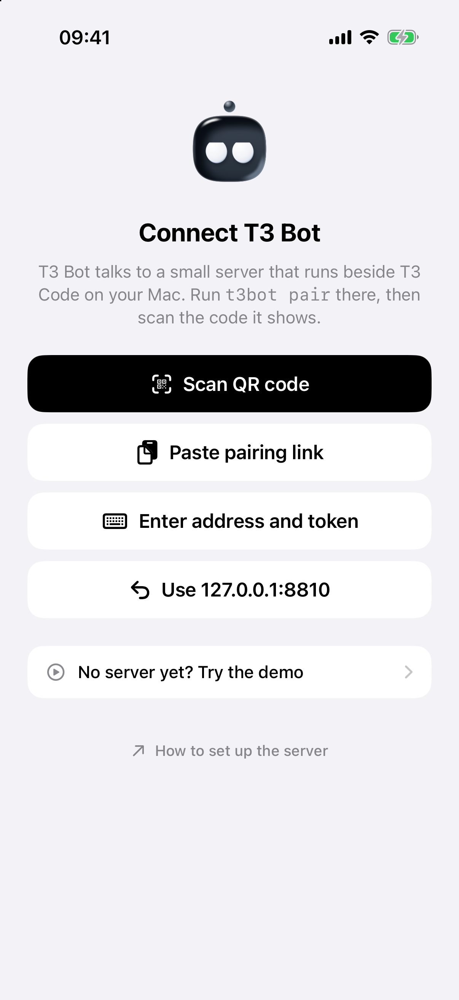

# Setup

This takes you from a fresh clone to T3 Bot on your iPhone, paired with T3 Code. Plan for about 20 minutes, most of it in Xcode. Notifications take another 15, on developer.apple.com and Vercel.

Nothing is installed on the Mac that runs T3 Code. The [T3 Bot server](#optional-the-t3-bot-server) of earlier versions still exists and is optional.

To have your coding agent do it, paste the prompt from the [README](../README.md#build-scan-done); it follows [AGENT-SETUP.md](AGENT-SETUP.md). If you only want to look at the app, [the demo](#the-demo) needs none of this.

## What you need

| | Why |
|---|---|
| T3 Code running on your computer, with at least one project | The app pairs with it |
| A Mac with Xcode 27 and [XcodeGen](https://github.com/yonaskolb/XcodeGen) | Builds the app. `brew install xcodegen` |
| An iPhone on iOS 26 | The app is iPhone only |
| A paid Apple Developer account | Signing the app's notification entitlements. There is no TestFlight or App Store build |
| A [Vercel](https://vercel.com) account and its CLI (for notifications) | Hosts your push sender. The free plan is enough |

The computer that runs T3 Code and the Mac that runs Xcode can be two machines.

## 1. Build the app with your own team

On the Mac with Xcode:

```sh
brew install xcodegen
git clone https://github.com/Soren-Starck/t3-bot
cd t3-bot
ios/scripts/setup.sh
```

`setup.sh` asks for two values, writes them to `ios/Config/Local.xcconfig` (not committed) and generates the Xcode project:

- your team ID, the ten letters and digits under Membership details on developer.apple.com;
- a bundle identifier prefix of your own, like the reverse of a domain you own. The app becomes `<prefix>.t3bot`.

To skip the questions: `ios/scripts/setup.sh --team <your team id> --bundle-prefix <your prefix>`, or `--bundle-id <id>` for a whole identifier. `ios/scripts/setup.sh --help` lists every option and `ios/Config/Local.example.xcconfig` explains every value. Do not edit `ios/Config/T3Bot.xcconfig` or `ios/project.yml` for this: they hold the defaults, and your file wins over them.

The project has four targets: the app (`T3Bot`), a notification service extension (`T3BotNotify`), widgets (`T3BotWidgets`) and a share extension (`T3BotShare`). Their bundle identifiers are yours with `.notify`, `.widgets` and `.share` added.

Sign in to your Apple account under Xcode > Settings > Accounts. Then put the app on the iPhone, one of two ways:

- **Xcode.** `open ios/T3Bot.xcodeproj`, choose the `T3Bot` scheme, plug in your iPhone, choose it as the destination and press Run. Xcode registers the four identifiers and makes the profiles the first time.
- **Terminal.** `ios/scripts/run-on-iphone.sh`, with the iPhone plugged in, unlocked and trusted. It builds, installs and opens the app. With several iPhones connected, pass the identifier of one from `xcrun devicectl list devices`.

The iPhone needs Developer Mode on (Settings > Privacy & Security > Developer Mode).

The app needs these capabilities on its App ID: Push Notifications, Time Sensitive Notifications, Communication Notifications, and Keychain Sharing (the extensions read the pairing from a shared Keychain group). Automatic signing adds them when it can. A signing error here almost always means one is missing, most often Communication Notifications. Open the identifier on developer.apple.com (Certificates, Identifiers & Profiles) and tick it there.

If you make the four provisioning profiles yourself, pass their names: `ios/scripts/setup.sh --team <id> --bundle-id <id> --manual <app> <notify> <widgets> <share>`. `--reset` removes your values again.

To update the app later, `git pull` in the clone and build again.

## 2. Pair with T3 Code

1. On the computer, in T3 Code, open Settings > Sharing & access and choose Create link. T3 Code shows a QR code and a link.
2. In T3 Bot, tap "Scan the code from T3 Code" and point the phone at the QR code.

When T3 Code runs headless, `t3 pair` on that machine prints a pairing QR code in the terminal.

<picture>
  <source media="(prefers-color-scheme: dark)" srcset="screenshots/connect-dark.png">
  
</picture>

The app trades the code for a token, keeps the token in the iPhone's Keychain and shows your bots. A code works once and only for a few minutes, so create a new link if it has expired. T3 Code lists the phone under Sharing & access as "T3 Bot on <the iPhone's name>", and you can remove it there at any time. The token lasts 30 days; after that the app asks you to pair again.

"Other ways to connect" on the same screen has two more:

- **Paste link** takes the link itself, when the QR code is not in front of you.
- **Enter code** takes an address and the code. Use it away from home with your T3 Connect address (it looks like `https://<name>.t3coderelay.com`), or with a Tailscale address. The address T3 Code gives under "Copy MCP URL" works as it is.

The phone must be able to reach the address in the link. A link made on your home network works on that network. For anywhere else, pair with the T3 Connect or Tailscale address.

A bot is a T3 Code thread titled `%BOT <Name>`, in any project. A group chat is titled `%BOT Group: <Name>`. If you have none yet, make the first one in the app. Its face and its job are kept on the phone.

The app holds one pairing at a time. Pairing with another T3 Code, or with a T3 Bot server, replaces it and forgets the chats and drafts saved from the old one.

## 3. Notifications

A fresh build has no push sender set, so notifications are off: the app shows everything when you open it and nothing rings. This step turns them on.

Apple only lets the owner of an app's signing team send it pushes. Your build is signed by your team, so the pushes come from a small sender you deploy yourself with your own push key: three small Vercel functions in `push/`.

1. Deploy the sender. [push/README.md](../push/README.md) has the steps: an APNs key from developer.apple.com, a few environment variables, one deploy. Its list of allowed apps (the `ALLOWED_TOPICS` setting) must hold your app's bundle identifier, the one `setup.sh` printed (`<prefix>.t3bot`).
2. Tell the build where it is, then build and install again:

   ```sh
   ios/scripts/setup.sh --push-host <your sender's host name>
   ```

   It keeps the team and identifier it saved before. The host name has no `https://` and no path.

3. Open the app and allow notifications. Under Settings > Notifications, "Ring this phone" is on and "Send a test push" rings the phone through your sender.

What "Ring this phone" does: it adds Claude Code hooks to the launch arguments of each Claude provider in T3 Code's settings (a `--settings` argument marked `T3BOT_HOOKS`). When a hook fires, it calls your sender with a sealed address for this phone, the thread's id and the kind of event. The sender pushes, and the phone reads the words from T3 Code. Turning "Ring this phone" off takes this phone out of the hooks. Each paired phone adds itself and removes only itself.

| Event | Rings |
|---|---|
| A Claude thread asks a question or needs an approval, in any project | Yes, with the question's own choices as buttons |
| A bot finishes a reply | Yes |
| A Codex thread, or any provider that is not Claude | Not yet |
| A thread that is not a bot finishes | No |

Limits to know:

- Claude Code reads its hooks when a session starts. A thread that was already running rings from its next session.
- A Claude provider that already has its own `--settings` in its launch arguments, or that sets environment values, is left alone and does not ring.
- During the quiet hours you set in the app, pushes arrive without sound and do not light the screen. Holding them until morning needs the server.

## What works without the server

Paired with T3 Code you get the bots and their chats, photos, questions and approvals with their buttons, new bots from the phone, search, the share extension, the widgets and T3 Code's scheduled tasks.

These need the server: cards from your scripts and agents (`t3bot notify`, sources and handlers, see [CARDS.md](CARDS.md)), drafts, sharing the phone's calendar and contacts, pushes held during quiet hours, the evening summary and the morning brief. In this mode Settings says the morning brief and sharing the calendar and contacts need a server.

## Optional: the T3 Bot server

The server is a Bun program that runs beside T3 Code on a Mac that stays on. The phone pairs with it instead of with T3 Code. It adds what the list above names, sends pushes itself with your own push key (no push sender), and rings for every provider, Codex included.

Everything from here to [Troubleshooting](#troubleshooting) is about the server. Skip it if you paired with T3 Code. The app is the same build as in [step 1](#1-build-the-app-with-your-own-team); only the pairing differs.

It needs [Bun](https://bun.sh), which runs the server and the `t3bot` command. Tailscale on the Mac and the phone is recommended: it gives the server an HTTPS address that works away from home. Google Chrome or Chromium on the server Mac is optional: it is used headless to draw a new bot's still face in its own colours for notifications, and without it the stock picture of the face is used.

### Install the server

On the Mac that runs T3 Code, with T3 Code open and at least one project in it:

```sh
git clone https://github.com/Soren-Starck/t3-bot
cd t3-bot
deploy/install.sh
```

The installer:

- creates `~/.config/t3bot/` (mode 700) and a random token in `~/.config/t3bot/token` (mode 600), unless one exists;
- picks the address your phone will use: Tailscale Serve when Tailscale is connected on this Mac (it runs `tailscale serve --bg --https=8809 http://127.0.0.1:8809`), otherwise this Mac's address on your home network;
- installs a LaunchAgent (`com.t3bot.server`) so the server starts at login and restarts if it stops, with its log in `~/Library/Logs/t3bot.log`;
- links the `t3bot` command into `~/.local/bin` (put that folder on your `PATH`);
- waits until `http://127.0.0.1:8809/health` answers;
- runs `t3bot setup` if there is no bot yet, then `t3bot pair`, which prints the QR code for [pairing](#pair-the-phone-with-the-server).

Run it again at any time: it restarts the server and keeps the token, the config and the data.

| Option | Meaning |
|---|---|
| `--dry-run` | Print what would be done and change nothing |
| `--lan` | Do not use Tailscale even when it is connected |
| `--no-pair` | Do not print the pairing code at the end |
| `--project <name>`, `--name <your name>` | Passed to `t3bot setup` |
| `--label <launchd label>` | Another name for the LaunchAgent, for a second install on the same Mac |
| `--uninstall` | Stop the server and remove the LaunchAgent and the command |

Every route except `/health` and the bots' face pictures needs the token.

### First run

The installer has already done this. To do it by hand, or again:

```sh
t3bot setup
```

It finds your T3 Code install, asks which project your bots should live in when there are several, creates the first bot's thread there (titled `%BOT Chief`), and writes `~/.config/t3bot/agents.json`. After that you add and edit bots in the app. A config that already has bots is never replaced unless you add `--force`, and then a copy is kept beside it.

| Option | Meaning |
|---|---|
| `--project <name, id or path>` | The T3 Code project, without being asked |
| `--name <your name>` | What bots call you. Default: the first name of your macOS account |
| `--dry-run` | Show what it would do. Nothing is written and nothing is sent to T3 Code |
| `--force` | Start over with a new Chief |

Then check everything:

```sh
t3bot doctor
```

`doctor` reports on Bun, T3 Code, the config, each bot's thread, the rules files, the token, the server, the address your phone can use and the push key. Fix what it flags before going on.

#### The config file

The server looks for its config in this order:

1. the path in `$T3BOT_CONFIG`
2. `~/.config/t3bot/agents.json`
3. `config/agents.json` in the clone

The rules files `BOTS.md`, `CHIEF.md` and `GROUP.md` are the standing instructions a new bot is told to read. The server looks for each one beside the config file, then in `~/.config/t3bot/`, then uses the one shipped in `config/`. To change how your bots answer, copy them from `config/` to `~/.config/t3bot/` and edit the copies.

The file is read again whenever it changes, so there is no restart after an edit. A small one looks like this (`config/agents.example.json` is a longer one, with a second bot, a group, a source and a handler):

```json
{
  "environmentId": "<your T3 environment id>",
  "projectId": "<the T3 project your bots live in>",
  "user": { "name": "Ada" },
  "night": { "from": "23:00", "to": "08:00" },
  "digestAt": "20:00",
  "keepDays": 180,
  "chief": "chief",
  "defaults": { "model": "claude-opus-5-5", "effort": "high", "runtimeMode": "full-access" },
  "agents": [
    {
      "id": "chief",
      "name": "Chief",
      "role": "First contact. Everything that has no other bot.",
      "threadId": "<thread id>",
      "watch": [],
      "kind": "bot",
      "face": { "skin": "902" }
    }
  ],
  "sources": [],
  "handlers": {}
}
```

| Key | Meaning |
|---|---|
| `environmentId`, `projectId` | Filled in by `t3bot setup` |
| `user.name` | What bots call you. Left out, they say "the user" |
| `night` | Default quiet hours. You can change them in the app's settings |
| `digestAt` | When the evening summary of what agents did alone is sent if quiet hours are off. With quiet hours on, it is sent 15 minutes before they start |
| `keepDays` | How many days of history the server keeps. `t3bot setup` writes 180. Left out or 0, nothing is ever deleted. See [What the server keeps](#what-the-server-keeps) |
| `chief` | The bot that gets everything no other bot claims. Default: the agent with id `chief`, else the first bot |
| `defaults` | `model`, `effort`, `runtimeMode` and `instanceId` (T3 Code's provider instance, `claudeAgent` by default) for threads the app creates |
| `agents[].watch` | Thread title prefixes. A question from a thread whose title starts with one of them is shown under this bot, and the bot shows as watching while such a thread works |
| `agents[].kind` | `bot`, or `group` for a group chat with `members` |
| `sources`, `handlers` | Your own cards. See [CARDS.md](CARDS.md) |

`defaults.runtimeMode` set to `full-access` means a new bot's thread runs commands without asking. Lower it if you want approvals.

### Make the server reachable from your phone

The installer has set this up one of two ways. `t3bot doctor` prints the address it found.

**With Tailscale** connected on the Mac and the phone, the server stays on `127.0.0.1` and Tailscale Serve forwards to it. Its address is `https://<machine>.<your-tailnet>.ts.net:8809`, reachable only from your own tailnet, at home or away. If you install Tailscale later, run `deploy/install.sh` again.

**Without Tailscale**, the installer starts the server with `T3BOT_HOST=0.0.0.0` and the address is `http://<the Mac's address>:8809`. It works while the phone is on the same Wi-Fi. The traffic is plain http, so anyone on that network could read it: use it at home only. If the phone cannot connect, the macOS firewall may be blocking incoming connections to `bun` (System Settings, Network, Firewall).

Any other private HTTPS front that forwards to `127.0.0.1:8809` works too. Tell `t3bot pair` about it with `--url <address>`, or set `T3BOT_PUBLIC_URL`. The app accepts plain http only for an address on the local network, so a public host name needs HTTPS. Do not publish the port on the open internet: the token is the only thing in front of your agents.

### Pair the phone with the server

On the server Mac:

```sh
t3bot pair
```

It prints a QR code and a link of the form `t3bot://connect?url=<server address>&token=<token>`. In the app's connect screen, scan the QR code with the same button that scans a T3 Code link. You can also scan it with the iPhone camera, open the link on the phone, or paste it into the connect screen.

| Option | Meaning |
|---|---|
| `--url <address>` | Use this address in the link |
| `--no-qr` | Print the link only, with a line of explanation |
| `--link-only` | Print the link and nothing else, for a script |
| `--invert` | Swap the QR code's colours, if the phone cannot read it on your terminal |

The link contains your token. Treat it like a password: do not paste it into a chat or a screenshot.

The app checks the address and token, then shows your bots. Settings shows the server's version.

To use the `t3bot` command on another computer of yours, run `t3bot connect '<the link>'` there. It saves the address and the token for that computer.

### Pushes from the server

The server sends pushes itself, with a push key of your team. It does not use the push sender. Without a key, the app shows everything when you open it and nothing rings.

1. On developer.apple.com, go to Certificates, Identifiers & Profiles, then Keys. Create a key with "Apple Push Notifications service (APNs)" enabled.
2. Download the `.p8` file. Apple lets you download it once. Note the Key ID shown beside it and your Team ID (Membership details).
3. Move the key to the server Mac and lock it down:

   ```sh
   mv ~/Downloads/AuthKey_XXXXXXXXXX.p8 ~/.config/t3bot/
   chmod 600 ~/.config/t3bot/AuthKey_XXXXXXXXXX.p8
   ```

4. Write `~/.config/t3bot/apns.json`:

   ```json
   {
     "keyId": "XXXXXXXXXX",
     "teamId": "YYYYYYYYYY",
     "keyPath": "~/.config/t3bot/AuthKey_XXXXXXXXXX.p8",
     "topic": "<the app's bundle identifier>"
   }
   ```

   ```sh
   chmod 600 ~/.config/t3bot/apns.json
   ```

   The server reads the file when it sends, so there is no restart. `t3bot doctor` says whether it is complete.

5. Open the app once so it registers the phone, allow notifications, then send a test push from the app's settings, or from the Mac:

   ```sh
   curl -s -X POST -H "Authorization: Bearer $(cat ~/.config/t3bot/token)" \
     -H 'content-type: application/json' -d '{}' http://127.0.0.1:8809/v1/test-push
   ```

   The answer says how many phones are registered and whether the push key is usable: `{"ok":true,"devices":1,"push":true}`. The test push rings during quiet hours too.

A build installed from Xcode uses Apple's sandbox push environment, and the project is set up for that. The app tells the server which environment its build uses.

What rings, and when:

| Event | Push |
|---|---|
| An agent asks a question or needs an approval, in any T3 thread | At once by day, held during quiet hours |
| A bot finishes a reply to a message you sent | At once by day, held during quiet hours |
| `t3bot notify --kind alarm` | At once, time sensitive. During quiet hours too if you allow alarms in the app's settings |
| `t3bot notify --kind approve` or `do`, and `t3bot draft` | At once by day, held during quiet hours |
| A new card from a source with `urgency` `now` or `today` | At once by day, held during quiet hours |
| `t3bot notify --kind know` | Never. It goes into the evening summary |
| The morning brief, if you turn it on | When quiet hours end, or at the time you set |

Held pushes become one "While you slept" notification when quiet hours end. Quiet hours, the morning brief and quick replies are in the app's settings. With quiet hours turned off, nothing is held.

Quick replies are the short answers you save in the app's settings. The server offers them under a bot's last message only when that message asks you something (it ends with a question, or asks you to choose or to give a go-ahead) and the bot suggested no replies of its own. A bot's own suggestions always come instead of yours.

### Environment variables

None is needed for a normal install. The first seven are written into the LaunchAgent when they are set as `deploy/install.sh` runs (`T3BOT_PORT=8811 deploy/install.sh`), so the server keeps them across restarts.

| Variable | Meaning |
|---|---|
| `T3BOT_PORT` | The server's port. Default 8809. The `t3bot` command reads it too, to find the server on this computer |
| `T3BOT_HOST` | The address the server listens on. Default `127.0.0.1`. The installer sets `0.0.0.0` when there is no Tailscale |
| `T3BOT_CONFIG` | Path of the config file |
| `T3BOT_CONFIG_DIR` | Folder of the token, the push key file and your config. Default `~/.config/t3bot` |
| `T3BOT_DATA_DIR` | Folder of the server's own state. Default `~/.local/share/t3bot` |
| `T3BOT_TOKEN_FILE` | Path of the token file. Default `~/.config/t3bot/token` |
| `T3BOT_KEEP_DAYS` | How many days of history the server keeps. It wins over `keepDays` in the config, and 0 keeps everything. See [What the server keeps](#what-the-server-keeps) |
| `T3BOT_LABEL` | The LaunchAgent's label, for the installer only. Same as `--label` |
| `T3BOT_PUBLIC_URL` | The address `t3bot pair` puts in the link |
| `T3BOT_URL`, `T3BOT_TOKEN` | Where the `t3bot` command finds the server, and the token it sends. Default: what `t3bot connect` saved, else this computer |
| `T3BOT_T3_HOME` | T3 Code's data folder, when it is not `~/.t3`. `T3CODE_HOME` is read too |
| `T3BOT_T3_DB` | Path of T3 Code's SQLite file, when it is not `userdata/statev2.sqlite` in that folder |
| `T3BOT_T3_CLI` | Path of T3 Code's `t3` command, when the server cannot find it |
| `T3BOT_NO_PUSH=1` | Send no pushes. They are logged |
| `T3BOT_READONLY=1` | Send nothing to T3 Code. The app can read, and every message or answer is refused |
| `T3BOT_LOG_FILE` | The server's log file, which it trims once it passes 5 MB. The installer sets it to `~/Library/Logs/t3bot.log` |
| `T3BOT_DEMO_PORT` | The demo server's port when `--port` is not given. Default 8810 |
| `T3BOT_DEMO_HOST` | The address the demo server listens on. Default `127.0.0.1`, this computer only |

### Updating

```sh
cd t3-bot
git pull
deploy/install.sh --no-pair
```

Then rebuild the app from Xcode if `ios/` changed.

### What the server keeps

The server keeps its own state in `~/.local/share/t3bot/`: a small SQLite file (snoozes, notes, registered phones, settings, the record of card taps) and, in `uploads/`, the photos you sent from the phone. It never writes to T3 Code's database, and your conversations stay in T3 Code whatever is set here.

`keepDays` in the config says how long that history is kept. Once an hour the server deletes what is older than that many days:

- photos sent from the phone (an old chat then shows a missing picture where one was)
- notes you have read or handled, and the notes of the evening summary
- the record of which card button was tapped

A note you have not read is never deleted. `t3bot setup` writes `"keepDays": 180` into a new config. A config without the key, or with 0, keeps everything forever. `T3BOT_KEEP_DAYS` in the server's environment wins over the config.

## Troubleshooting

Paired with T3 Code:

| Symptom | Likely cause |
|---|---|
| The code is refused when you scan or type it | A code works once and for a few minutes. Create a new link in T3 Code |
| "This T3 Code is too new" | T3 Code changed its protocol. Pull the latest T3 Bot and build again |
| "refused this phone's token. Pair again to carry on." | The 30 days are over, or the phone was removed under Sharing & access. Pair again |
| The app cannot reach T3 Code away from home | The pairing uses a home network address. Pair again with your T3 Connect or Tailscale address |
| "This build of T3 Bot has no push sender set." | A fresh build has no push sender. Deploy yours ([push/README.md](../push/README.md)), run `ios/scripts/setup.sh --push-host <its host name>` and build again |
| "The push sender said no: this sender does not push to that app" | The sender's `ALLOWED_TOPICS` does not hold your bundle identifier, or the build points at someone else's sender |
| "already has its own --settings in T3 Code's launch arguments" | That Claude provider has its own `--settings` argument, so the hooks cannot be added to it |
| "T3 Code runs no Claude provider here." | Notifications come from Claude threads only |
| "This pairing may not change T3 Code's provider settings." | The link was made with less access. Create a link with the standard access and pair again |
| A Claude thread asked and nothing rang | The thread started before the hooks were added (it rings from its next session), or notifications are denied in iOS Settings |
| A Codex thread asked and nothing rang | Expected. Only Claude threads ring in this mode |
| Pushes arrive without the bot's face | The Communication Notifications capability is missing on the App ID |
| Widgets are empty | Open the app once after pairing so the extensions can read the connection |

Paired with a server, start with `t3bot doctor`. The server's log is `~/Library/Logs/t3bot.log`.

| Symptom | Likely cause |
|---|---|
| The log says the port is already in use | Another T3 Bot server, or another program, holds port 8809. `t3bot doctor` shows a server that already runs. To move this one, install it with another port, `T3BOT_PORT=8811 deploy/install.sh`, and export the same `T3BOT_PORT` in your shell so the `t3bot` command looks there |
| The log says it cannot create its token file or open its data folder | The folder cannot be written by your account. Fix its owner, or point `T3BOT_TOKEN_FILE` or `T3BOT_DATA_DIR` somewhere you can write |
| The app says T3 Code is not set up on this machine | The server found no T3 Code data at `~/.t3`. Install T3 Code and open it once. If it keeps its data elsewhere, set `T3BOT_T3_HOME` |
| The app says it cannot read the data of this T3 Code | T3 Code and T3 Bot are too far apart in version. Update both, then run `deploy/install.sh --no-pair` to restart the server |
| A bot's chat is empty and sending says its thread no longer exists | The thread was deleted in T3 Code. Hide the bot in the app, or make a new one |
| The connect screen says the server cannot be reached | With Tailscale: the phone is not on your tailnet, or Tailscale Serve is not running. Without: the phone is on another network, or the macOS firewall blocks `bun`. Open `<address>/health` in Safari on the phone: it should print `{"ok":true}` |
| "Unauthorized" | The token in the app is not the one in `~/.config/t3bot/token`. Run `t3bot pair` again |
| Bots are listed but messages do not send | T3 Code is not running, or it was updated and changed something T3 Bot relies on. Check the server log and the project's issues |
| No pushes | No `apns.json`, a wrong `topic` (it must be the app's bundle identifier), notifications denied in iOS Settings, or quiet hours |
| Pushes arrive without the bot's face | The Communication Notifications capability is missing on the App ID |

## The demo

To see the app before building it for a phone: a pretend server with made-up bots that answer everything, and the app in the iPhone simulator. It needs no T3 Code, no Apple account and no signing, only [Bun](https://bun.sh), Xcode 27 and XcodeGen.

```sh
git clone https://github.com/Soren-Starck/t3-bot
cd t3-bot
bin/t3bot demo
```

Leave it running. In a second terminal, in the same `t3-bot` folder, run `cd ios && xcodegen generate && open T3Bot.xcodeproj`, then run the `T3Bot` scheme on an iPhone simulator. On the connect screen, open "Just looking? Try the demo" and tap "Connect to the demo on this Mac". The demo saves nothing and sends no pushes.

The demo listens on this computer only, which is all the simulator needs. Its token is the public word `demo`, so it stays closed to your network unless you ask: `bin/t3bot demo --lan` opens it to an iPhone on the same Wi-Fi and prints a code to scan. That needs the app already built on the phone ([step 1](#1-build-the-app-with-your-own-team)).

## Uninstall

Paired with T3 Code:

1. In the app, turn off Settings > Notifications > Ring this phone. That takes the hooks out of T3 Code's Claude settings.
2. In T3 Code, remove the phone under Settings > Sharing & access.
3. Delete the app from the iPhone, and the push sender's project on Vercel if you deployed one.

With a server:

```sh
deploy/install.sh --uninstall
rm -r ~/.config/t3bot ~/.local/share/t3bot
tailscale serve --https=8809 off
```

The first line stops the server and removes the LaunchAgent and the `t3bot` command. The second removes your config, token, push key and the server's state. The third applies only if Tailscale served it.

Your bots' threads stay in T3 Code. Rename or archive them there.
